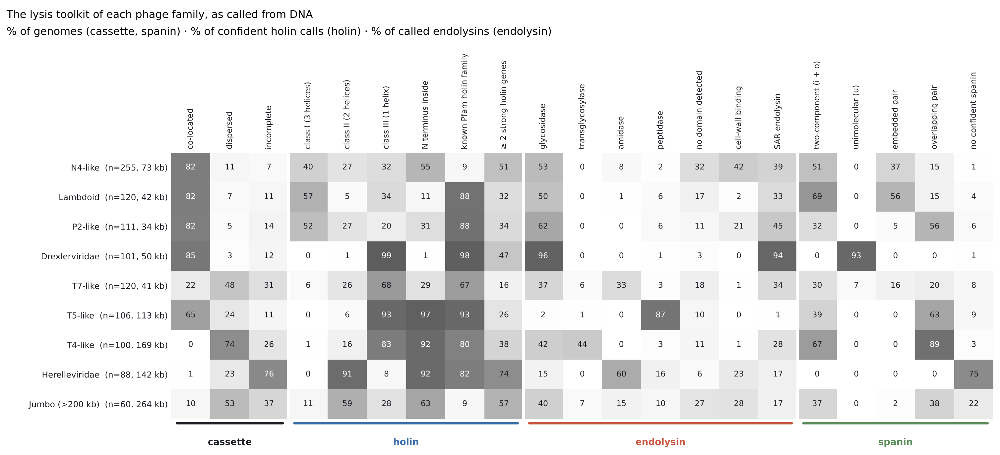
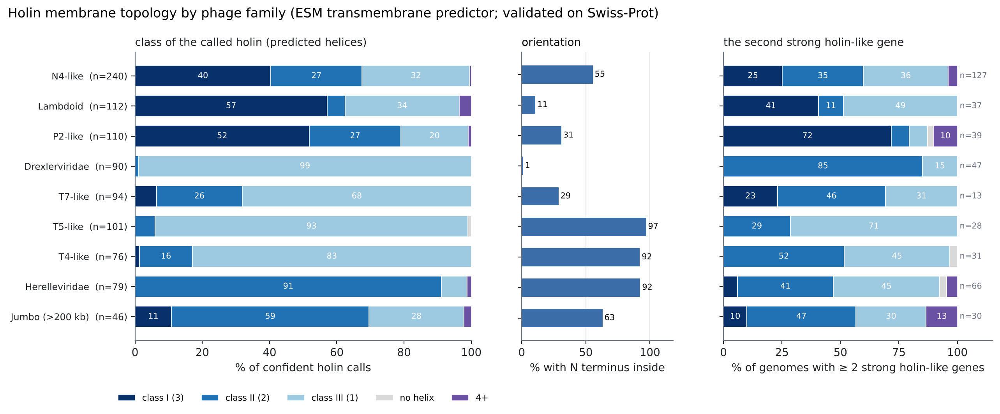
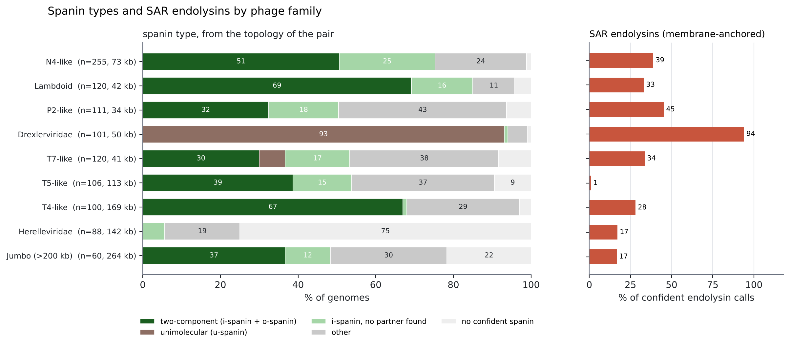

# How lysis genes are built and arranged across phage families

Data: the blind DNA-only calls for 1,061 genomes in nine groups (`../groups/groups_scan.md`, `../n4/n4_scan.md`),
re-derived protein sequences, and Pfam domains -- no annotation names (`scripts/54_lysis_distribution.py`; per-genome
table `lysis_by_genome.csv`; figures `scripts/54b`, all checked for overlapping text). Every value is a model call or
a sequence property, so it carries the predictor's error rates for that group (lowest agreement: T4-like endolysins
0.61, jumbo phages); read it as a map of what the predictor sees.

## Patterns that match known biology (a check that the calls are meaningful)

- **Endolysin chemistry is family-specific.** T5-like 87% peptidase (T5's endolysin is an L-alanoyl-D-glutamate
  peptidase); T7-like 33% amidase (T7 gp3.5 is an N-acetylmuramoyl-L-alanine amidase); Drexlerviridae 96%
  glycosidase; Herelleviridae (Gram-positive hosts) 60% amidase, the longest endolysins (median 341 aa) and the most
  cell-wall-binding domains (23%) -- the modular Gram-positive endolysin.
- **Spanins follow the host envelope and the phage family.** Herelleviridae: no confident spanin in 75% (Gram-positive
  hosts have no outer membrane). Drexlerviridae: 99% a single spanin gene, 97% with a lipobox -- the unimolecular
  spanin of phage T1, which belongs to this family. Lambdoid phages: 56% embedded (lambda Rz1 inside Rz). T4-like 89%
  and T5-like 63% overlapping pairs.
- **Cassettes are compact in small phages, scattered in T4.** Co-located in 82-85% of N4-like, lambdoid, P2-like and
  Drexlerviridae genomes; never in T4-like (0%; 74% dispersed), whose lysis genes are known to be spread around the
  genome. Order is strongly conserved: holin-endolysin-spanin in 97-99% of co-located lambdoid, P2-like and
  Drexlerviridae cassettes; spanin-holin-endolysin in 100% of T5-like ones.
- **Holin size.** T4-like and T5-like holins cluster at ~218 aa (the T4 t size: one membrane helix plus a large
  periplasmic domain); Drexlerviridae ~72 aa and T7-like ~69 aa (small holins); lambdoid ~108 aa.

## Patterns worth following up

- **N4-like phages:** two or more strong holin-like genes in 51% of genomes (the two-holin pattern), only 8% of their
  holins match any known Pfam holin family, and 32% of their endolysins carry no recognised catalytic domain -- the
  most novel lysis machinery of the groups scanned, while still detected confidently.
- **Jumbo phages:** only 7% of holins in a known Pfam family, 27% of endolysins without a recognised domain, cassettes
  rarely co-located (10%).
- **Herelleviridae:** 74% carry two or more strong holin-like genes.

## Membrane topology: holin classes, spanin types, SAR endolysins

A transmembrane-helix predictor was trained for this (`scripts/55_tm_predictor.py`, report `../tm_predictor.json`):
ESM-2 per-residue embeddings plus local hydropathy, logistic regression, trained on 3,225 Swiss-Prot bacterial and
viral proteins with helical topology, soluble proteins, and signal-peptide proteins (so a signal peptide is not called
a helix). All phage lysis proteins were held out.

| held-out test | this predictor | old hydropathy heuristic |
|---|---|---|
| Swiss-Prot proteins: exact helix count | **0.88** | 0.56 |
| Swiss-Prot proteins: helices recovered | **0.96** | 0.74 |
| signal-peptide proteins correctly given no helix | **0.95** | 0.35 |
| N-terminus side, positive-inside rule (465 independent proteins) | **0.87** | – |
| lambda S / T4 t | **3 helices N-out / 1 helix N-in** (as published) | 1 / 1 |

On the 59 held-out phage lysis proteins it disagrees with UniProt mostly where UniProt is behind the literature
(lambda S, P22 gp13 and related holins: 3 helices, UniProt lists 2; pinholin KMV44: 2, UniProt 1). Its blind spot is
the SAR domain of SAR endolysins, read as a signal rather than a helix, so SAR endolysins have their own rule (helix
probability >= 0.06 over the first 50 residues, or a hydropathy N-terminal segment): it separates all 13 Swiss-Prot
SAR endolysins from all 31 canonical ones, but was set on those same proteins, so it is calibrated, not independently
tested.

- **Holin classes follow the family.** Lambdoid and P2-like: mostly class I (3 helices; 57% and 52%), N terminus out
  (lambda S topology). T4-like and T5-like: class III (1 helix; 83% and 93%), N terminus in (T4 t topology).
  Herelleviridae (Gram-positive): class II (2 helices) in 91%, both termini in. N4-like: a mix (I 40%, II 27%,
  III 32%), and their second strong holin-like gene is again mixed -- the two-holin N4 cassettes pair different classes.
- **Spanin types.** Two-component (i-spanin + o-spanin) dominate lambdoid (69%) and T4-like (67%) phages;
  Drexlerviridae are 93% unimolecular (u-spanin: lipobox signal plus a C-terminal helix), as T1 is.
- **SAR endolysins** are most common in Drexlerviridae (94%) and P2-like phages (45%), rare in T5-like (1%).
  Drexlerviridae combine SAR endolysins with single-helix holins whose N terminus faces out -- the arrangement expected
  of a pinholin whose first, SAR-like helix is not detected; worth testing.

## Caveats

- Holin class = predicted helix count; a weak first helix (as in pinholins) can be missed, moving a class II holin to
  class III. Spanin "other" means a member could not be typed (e.g. no lipobox and no N-terminal helix).
- Spanin architecture uses confident spanin calls and the nearest strong partner; a missed partner shows as "single".
- Groups are samples (at most 15 genomes per host genus); counts are in the figures.

Figures: `figures/1_toolkit_heatmap.png`, `2_endolysin_classes.png`, `3_spanin_architecture.png`, `4_holins.png`,
`5_cassettes.png`.
