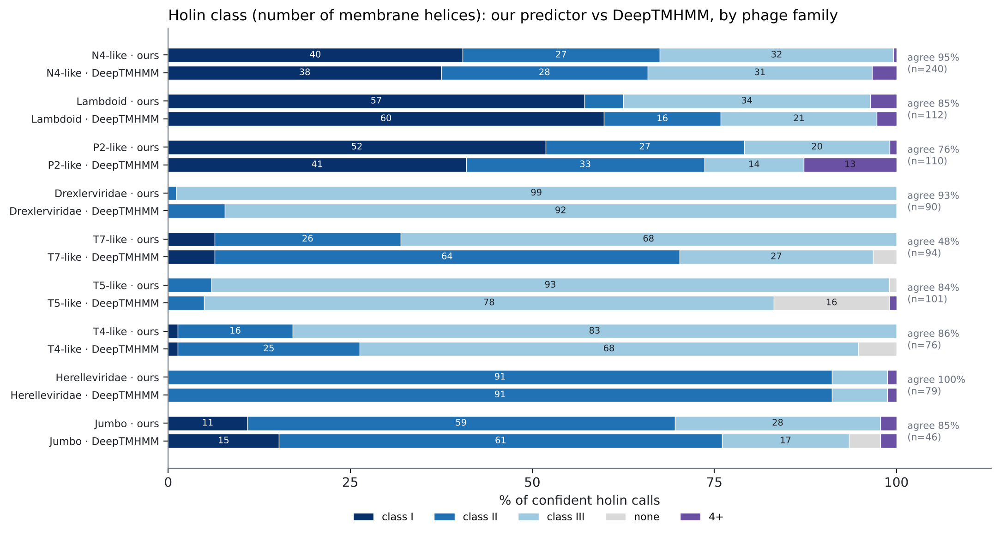
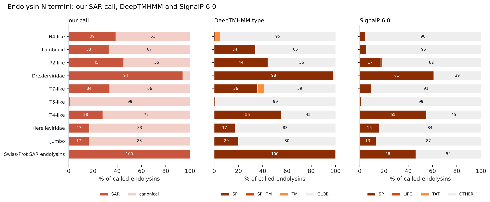

# Our transmembrane predictor vs DeepTMHMM and SignalP 6.0

All 2,693 distinct lysis proteins classified in the topology analysis (confident holin, second strong holin,
endolysin, and both spanin-pair members, in the nine phage-group scans) plus the 110 Swiss-Prot phage lysis proteins
were run through DeepTMHMM and SignalP 6.0 (DTU, on the BioLib cloud: `scripts/56_external_predictors.py`; the public
sequences were sent to BioLib's servers) and compared with our ESM-based predictor (`scripts/56b`; per-protein table
`per_protein.csv`; figures in `figures/`).

## Holins: the two predictors agree

- Same holin class in 76-100% of genomes in eight of nine families (Herelleviridae 100%, N4-like 95%, Drexlerviridae
  93%, T4-like 86%, lambdoid and jumbo 85%, T5-like 84%, P2-like 76%); 81% of the Swiss-Prot lysis proteins get the
  same helix count from both.
- Both give the literature topology for the reference holins: lambda S and P22 gp13 3 helices, N terminus out
  (UniProt lists 2); T4 t 1 helix, N in; phage 21 pinholin S 2 helices, N in.
- **T7-like holins are the exception (48% agreement):** DeepTMHMM calls most of them class II, ours class III. T7's own
  holin gp17.5 shows it: UniProt and ours 1 helix, DeepTMHMM 2 (a short first helix at 13-26). The sequence
  predictors cannot settle this; the T7-like holin class is unresolved.
- Exact helix count against UniProt on the 59 curated lysis proteins: ours 0.64, DeepTMHMM 0.53 -- but UniProt itself
  lists 2 helices for lambda S-type holins, so this benchmark penalises both tools where they match the literature.

## SAR endolysins: DeepTMHMM is the right external check, and mostly agrees with our rule

- On the 13 Swiss-Prot SAR endolysins, DeepTMHMM labels all 13 as signal-like N termini ("SP"); SignalP 6.0 only 6
  -- expected, since SignalP models CLEAVED signal peptides and a SAR anchor is never cleaved.
- Per family, our SAR rule and DeepTMHMM agree within a few points in six of nine families (lambdoid 33 vs 34%,
  P2-like 45 vs 44%, T7-like 34 vs 36%, T5-like 1 vs 1%, Herelleviridae 17 vs 17%, Drexlerviridae 94 vs 98%).
- **Disagreements:** N4-like 39% (ours) vs 1% (DeepTMHMM) -- our rule probably over-calls N4 endolysins; T4-like 28%
  vs 55% (DeepTMHMM and SignalP agree at 55%), in the family where endolysin calls are least reliable.
- Use: a SAR call is solid where our rule and DeepTMHMM agree; treat N4-like SAR calls as unconfirmed.

## Spanins: SignalP confirms the lipoproteins

- Of the 579 spanin-pair members our lipobox rule calls lipoproteins, SignalP 6.0 calls 577 lipoproteins (LIPO,
  Sec/SPII): 99.7% agreement. SignalP finds another 103 lipoproteins our stricter lipobox motif misses (72 members we
  could not type, 31 we typed as i-spanin-like) -- a sensitivity gain worth adopting.
- Swiss-Prot o-spanins: 7 of 9 LIPO; u-spanin (T1 gp11): LIPO; i-spanins: 11 of 11 OTHER (signal anchors, not cleaved
  signals), as expected.
- Holins: SignalP OTHER for 1,363 of 1,366 -- holins are not secreted.

## What changes

- Holin classes from our predictor stand (independently confirmed by DeepTMHMM), except T7-like (unresolved).
- SAR endolysins: report the consensus of our rule and DeepTMHMM.
- Lipoprotein (o-spanin, u-spanin) calls: SignalP LIPO is at least as reliable as our motif and more sensitive.
