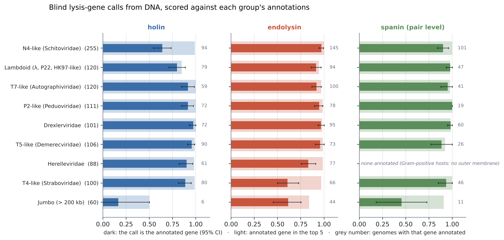

# Lysis genes across the major phage groups: blind scans from DNA

Same design as the N4-like scan (`../n4/n4_scan.md`): for each group, GenBank complete genomes not used for
evaluation or training, at most 15 per host genus, records over 800 kb removed (bacterial chromosomes filed under
phage taxa); the shipped predictor run on the DNA only; calls committed (66bc7ff, 2003c11) before any annotation
was read; then scored against each genome's own annotation (`scripts/52a-c`, figures `scripts/53`).

| group | genomes | all 3 confident | holin: call / top 5 | endolysin: call / top 5 | spanin pair / top 5 |
|---|---|---|---|---|---|
| N4-like (Schitoviridae) | 255 | 237 | 0.64 / 0.99 (94) | **0.97** / 1.00 (145) | 0.90 / 1.00 (101) |
| Lambdoid (λ, P22, HK97-like) | 120 | 107 | 0.80 / 0.85 (79) | 0.92 / 0.95 (94) | **0.98** / 0.98 (47) |
| T7-like (Autographiviridae) | 120 | 83 | 0.92 / 1.00 (59) | 0.92 / 0.97 (100) | 0.95 / 0.98 (41) |
| P2-like (Peduoviridae) | 111 | 96 | 0.92 / 1.00 (72) | 0.95 / 0.99 (78) | **1.00** / 1.00 (19) |
| Drexlerviridae | 101 | 89 | **0.97** / 1.00 (72) | **0.97** / 0.98 (95) | **0.98** / 0.98 (60) |
| T5-like (Demerecviridae) | 106 | 94 | **0.96** / 0.99 (90) | **0.96** / 0.99 (73) | 0.89 / 0.92 (26) |
| Herelleviridae (Gram-positive) | 88 | 21 | 0.90 / 0.98 (61) | 0.83 / 0.99 (77) | none annotated |
| T4-like (Straboviridae) | 100 | 74 | 0.89 / 0.99 (80) | 0.61 / 0.97 (66) | 0.94 / 1.00 (46) |
| Jumbo (> 200 kb) | 60 | 38 | 0.17 / 0.50 (6) | 0.61 / 0.84 (44) | 0.46 / 0.91 (11) |

"call" = the predictor's one call per class is the annotated gene; in brackets, genomes whose annotation has one.
Spanin is scored at pair level (the call is the annotated spanin or its overlapping partner).

## What the groups show

- **Most groups: 0.9 or better on all three genes.** Drexlerviridae, T5-like, P2-like and T7-like are at 0.89-1.00
  everywhere; the annotated gene is in the top 5 in 92-100% of genomes.
- **Gram-positive control.** Herelleviridae infect Gram-positive hosts, which have no outer membrane and so no
  spanins; none is annotated. The predictor makes a confident spanin call in 22 of 88 of these genomes, against
  87-99% in every Gram-negative group (T7-like 110/120 ... N4-like 252/255). It mostly recognises the absence; the 22
  are false positives.
- **N4-like holins:** two adjacent holin-family genes; the model and the annotation pick different ones
  (`../n4/n4_scan.md`).
- **Lambdoid holins: an annotation error, not a miss.** 10 of the 16 disagreements are one protein, identical in 10
  Vibrio phage genomes (Pel, pVa-2, H20, ...): annotated "holin" but 119 aa with no transmembrane segment and no
  similarity to any known holin. The model ranks it ~78th, correctly. Without those genomes the lambdoid holin call
  agrees in 63 of 69 (0.91).
- **T4-like endolysins: a false-positive family to fix.** T4's lysis genes are scattered (the endolysin e has no lysis
  neighbours), so proximity cannot help. In 23 of 26 disagreements the annotated endolysin is ranked 2nd; the call is a
  180-215 aa protein with no real similarity to any training endolysin (27-31% identity), annotated "hypothetical",
  "endoribonuclease" or "site-specific RNA endonuclease", scoring P 0.94-0.9999. That is a candidate set of hard
  negatives, the same kind of fix as the tail lysozymes (`../endolysin_virion_fix.md`).
- **Jumbo phages: weakest.** Few annotated lysis genes (holin 6, spanin 11), endolysin call 0.61 with the annotated
  gene in the top 5 in 84%. Jumbo-phage lysis is less well characterised, and their 300-600 genes give more chances
  for a wrong top pick; treat jumbo calls as a ranked shortlist.

Per-group figures: `reports/<group>/figures/` (agreement, novelty, cassette architecture, holin pairs where relevant).
